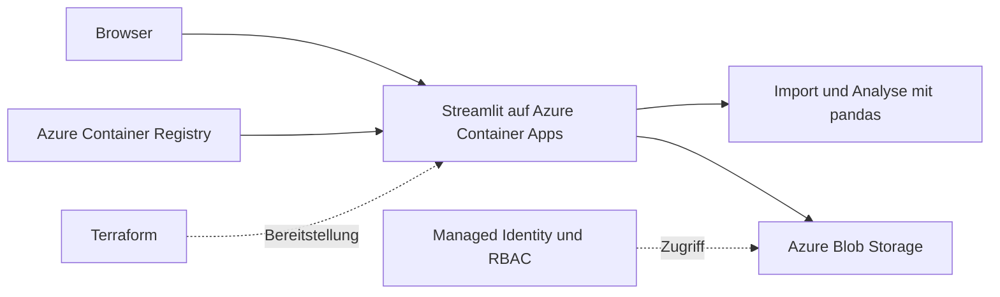
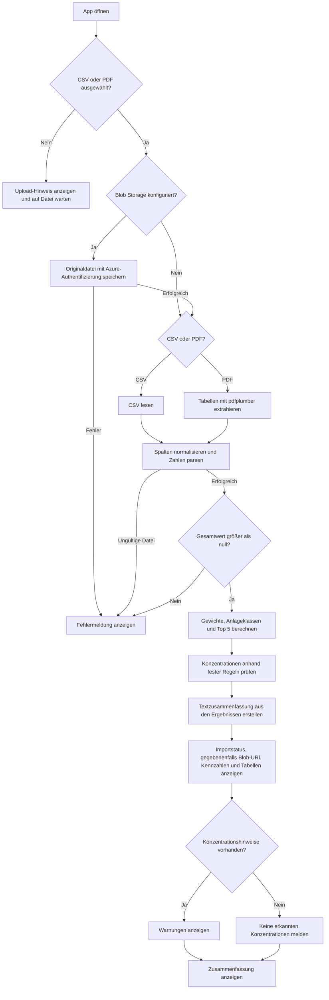

# Example Azure Depot PDF

Eine Python-Anwendung zur Analyse von Depotaufstellungen als CSV oder PDF, betrieben auf Azure Container Apps. Das Projekt verbindet einen funktionierenden Streamlit-Prototyp mit einer durch Terraform verwalteten Azure-Infrastruktur.

**[Live-Anwendung öffnen](https://ca-example-azure-depot-pdf-dev.blackstone-9f92ba64.switzerlandnorth.azurecontainerapps.io/)** · **[Projektpräsentation als PDF](docs/Example-Azure-Depot-PDF-Praesentation.pdf)**

## Funktionen

- Depotdateien im Browser hochladen oder per CLI einlesen.
- CSV-Spalten und Tabellen aus textbasierten PDFs normalisieren.
- Gesamtwert, Positionsgewichte und die fünf größten Positionen berechnen.
- Konzentrationen anhand fester Schwellenwerte erkennen.
- Eine regelbasierte Zusammenfassung aus den berechneten Ergebnissen erzeugen.
- Hochgeladene Dateien bei konfiguriertem Azure-Zugriff in einem privaten Blob-Container speichern.

Die Berechnungen laufen in Python und pandas. Die Zusammenfassung verwendet eine Textvorlage, keinen externen KI-Dienst. Das Projekt dient der technischen Demonstration und ist keine Anlageberatung.

## Architektur und Implementierungsstand

Die [ausführliche Architekturbeschreibung](docs/architecture.md) erklärt den Datenfluss, die Komponenten, Netzwerkgrenzen und den Betrieb. Ergänzend stehen [vollständige Ablauf-, Architektur- und Sequenzdiagramme](docs/architecture_diagram.md) zur Verfügung.



| Bestandteil | Aufgabe und aktueller Stand |
| --- | --- |
| Streamlit / pandas / pdfplumber | Aktiver Import- und Analyseablauf. |
| Azure Container Apps | Öffentlicher HTTPS-Endpunkt, Consumption-Profil, 0,5 vCPU und 1 GiB RAM. |
| Azure Container Registry Basic | Speichert das in Azure gebaute Linux/AMD64-Image. |
| Azure Blob Storage | Speichert Uploads. Private Container, deaktivierter anonymer Zugriff und Private Endpoint. |
| Managed Identity / RBAC | Zugriff der App auf Registry und Blob Storage ohne gespeicherte Zugriffsschlüssel. |
| PostgreSQL Flexible Server | Version 16, B1ms, 32 GiB Speicher, privates Netzwerk. Bereitgestellt, vom Analysecode noch nicht verwendet. |
| Azure Service Bus Standard | Namespace und Import-Queue bereitgestellt. Producer und Worker sind noch nicht implementiert. |
| Azure Key Vault | Mit Private Endpoint und deaktiviertem öffentlichem Netzwerk bereitgestellt. Die App liest derzeit keine Secrets daraus. |
| Log Analytics / Application Insights | Infrastruktur für Beobachtbarkeit und Neustartalarm vorhanden. Eine Instrumentierung des Python-Codes für Application Insights fehlt noch. |
| GitHub Actions | Baut das Docker-Image und führt den CLI-Smoke-Test aus. Kein automatisches Azure-Deployment. |

Die Anwendung läuft im Modus **Single Revision** mit genau einer Instanz. Dadurch bleiben die im Prozess gehaltene Streamlit-Sitzung und ihre Upload-Anfragen auf derselben Instanz.

## Vollständiger Funktionsablauf



Die gemeinsame Fehlerbehandlung umfasst auch nicht separat eingezeichnete Import-, Analyse- und Darstellungsfehler. Ein gespeicherter Blob bleibt bei einem späteren Fehler erhalten. Die Analyse läuft synchron und speichert Ergebnisse bisher nicht dauerhaft. Das [Detaildiagramm](docs/architecture_diagram.md#vollständiger-ablauf-der-webanwendung) beschreibt zusätzlich die Auswahl der Azure-Authentifizierung, die Importentscheidungen und den separaten CLI-Pfad.

## Lokal starten

Voraussetzungen: Python 3.11 und `pip`.

```bash
cd app
python3 -m venv .venv
source .venv/bin/activate
pip install -r requirements.txt
streamlit run app.py
```

Die Oberfläche ist anschließend unter `http://localhost:8501` erreichbar. Ohne Azure-Umgebungsvariablen funktioniert die Analyse lokal ohne Blob-Speicherung.

### CLI und Beispieldaten

Vom Repository-Stamm aus:

```bash
cd app
python cli.py ../samples/sample_depot.csv
```

Die Beispieldatei enthält **8 Positionen** mit einem Gesamtwert von **16.700,00**. Die größte Position hat ein Gewicht von ungefähr **25,1 %**.

### Docker

```bash
docker build --platform linux/amd64 -t example-azure-depot-pdf:local ./app
docker run --rm -p 8501:8501 example-azure-depot-pdf:local
```

## Dateiformate und Grenzen

Für CSV-Dateien sind `name`, `quantity` und `value` erforderlich. Der Importer erkennt auch bestimmte deutsche und englische Spaltenbezeichnungen, zum Beispiel `Wertpapier`, `Stückzahl` und `Marktwert`. `ticker` und `currency` sind optional.

PDFs müssen erkennbare Tabellen mit passenden Spalten enthalten. Der Importer nutzt `pdfplumber`; eine OCR für eingescannte Dokumente ist nicht implementiert. Bank- und brokerspezifische Layouts können zusätzliche Importregeln erfordern.

Weitere Grenzen des Prototyps:

- Keine Währungsumrechnung. Werte müssen vor einer gemeinsamen Auswertung in derselben Währung vorliegen.
- Anlageklassen sowie Technologie- und USA-Bezüge entstehen durch einfache Schlüsselwortregeln.
- Keine Kursdatenabfrage, Handelsfunktion oder Anbindung an ein Depotkonto.
- Keine Benutzeranmeldung oder Mandantentrennung in der Anwendung.
- Kein asynchroner Analyse-Worker und keine Speicherung der Analyseergebnisse in PostgreSQL.

## In Azure bereitstellen

Voraussetzungen: eine aktive Azure-Subscription, Azure CLI, Terraform ab Version 1.6, Python 3 sowie Berechtigungen zum Erstellen von Ressourcen und RBAC-Rollenzuweisungen. Der Build erfolgt in Azure Container Registry; ein lokaler Docker-Daemon ist dafür nicht erforderlich.

### 1. Anmelden und Dienste registrieren

```bash
az login
export AZURE_SUBSCRIPTION_ID="<subscription-id>"

for provider in Microsoft.App Microsoft.ContainerRegistry \
  Microsoft.DBforPostgreSQL Microsoft.Network Microsoft.Storage \
  Microsoft.KeyVault Microsoft.ServiceBus Microsoft.OperationalInsights \
  Microsoft.Insights Microsoft.ManagedIdentity; do
  az provider register --namespace "$provider" \
    --subscription "$AZURE_SUBSCRIPTION_ID" --wait
done
```

### 2. Build und Deployment ausführen

Vom Repository-Stamm aus:

```bash
scripts/deploy-azure.sh "$AZURE_SUBSCRIPTION_ID"
```

Das Skript wählt den Terraform-Workspace `azure-depot-pdf`, prüft einen vorhandenen State auf die passende Subscription und erstellt zunächst die Container Registry. Danach baut und veröffentlicht es ein versioniertes Image, erzeugt den vollständigen Terraform-Plan und wendet ihn an.

**Das Skript wendet den Plan ohne zusätzliche interaktive Bestätigung an.** Vor der Ausführung müssen Subscription und Konfiguration geprüft sein. Standardregion ist `switzerlandnorth`. Die Ressourcen verursachen laufende Kosten, auch bei geringer Nutzung. Insbesondere Datenbank, Registry, Private Endpoints und Service Bus haben nutzungsunabhängige Kostenanteile.

### 3. Betrieb prüfen

```bash
terraform -chdir=infra/terraform output -raw container_app_url
```

Der Streamlit-Healthcheck ist unter `/_stcore/health` erreichbar. Für den Funktionstest `samples/sample_depot.csv` im Browser hochladen und kontrollieren, ob Tabellen, Kennzahlen und die Bestätigung der Blob-Speicherung erscheinen.

## Terraform-State und Konfiguration

- Das aktuelle Deployment verwendet den Workspace `azure-depot-pdf`.
- Der lokale Workspace `default` enthält auf der bisherigen Entwicklungsmaschine den historischen State der alten Subscription. Er gehört nicht zum aktuellen Deployment.
- Workspace-State liegt lokal unter `infra/terraform/terraform.tfstate.d/`. Er enthält unter anderem das generierte Datenbankpasswort und gehört in eine geschützte Sicherung, nicht in Git.
- Das Deployment-Skript speichert Subscription und Image lokal in `infra/terraform/deployment.auto.tfvars.json`. Diese Datei ist ebenfalls von Git ausgeschlossen.
- `app.json` und `revision.json` sind historische Referenz-Snapshots mit angepassten Namen. Sie beschreiben nicht verbindlich die aktuelle Azure-Umgebung.
- Für eine Zusammenarbeit im Team sollte ein geschütztes Remote-Backend den lokalen State ersetzen. Ein frischer Clone enthält den produktiven State nicht und darf nicht unbesehen auf eine bestehende Umgebung angewendet werden.

## Zugriff auf Azure-Dienste

Die Anwendung wählt ihre zugewiesene Managed Identity über `AZURE_CLIENT_ID`. `AZURE_STORAGE_ACCOUNT_URL` und `AZURE_STORAGE_CONTAINER` bestimmen das Upload-Ziel. Für lokale Entwicklungsumgebungen unterstützt der Storage-Code alternativ `AZURE_STORAGE_CONNECTION_STRING`.

Key Vault und PostgreSQL sind über private Netzwerkanbindungen konfiguriert. Blob Storage hat ebenfalls einen Private Endpoint; sein öffentlicher Endpunkt bleibt für die Verwaltung des Containers durch Terraform erreichbar. Anonyme Zugriffe sind deaktiviert. Die öffentliche Streamlit-Oberfläche hat derzeit keine vorgeschaltete Benutzeranmeldung.

## Projektstruktur

```text
app/
  app.py                 Streamlit-Oberfläche
  cli.py                 Analyse über die Kommandozeile
  portfolio/             Import, Berechnungen, Zusammenfassung und Storage
  requirements.txt       Python-Abhängigkeiten
  Dockerfile             Container-Image
infra/terraform/          Azure-Ressourcen, Variablen und Outputs
docs/                     Architektur und Projektpräsentation
samples/sample_depot.csv  Beispieldaten für den Funktionstest
scripts/deploy-azure.sh   Build und Bereitstellung in Azure
.github/workflows/        Docker-Build und CLI-Smoke-Test
```

Der Paketname `portfolio` beschreibt weiterhin die fachliche Analyse. Der öffentliche Projektname lautet **Example Azure Depot PDF**, der technische Namensstamm `example-azure-depot-pdf`.

## Nächste Entwicklungsschritte

Benutzeranmeldung und Zugriffsschutz ergänzen, Importfehler mit weiteren Bankformaten testen und einen Remote-State einrichten. Danach können ein Service-Bus-Worker, die Speicherung von Analyseergebnissen und eine gezielte Application-Insights-Instrumentierung folgen.
