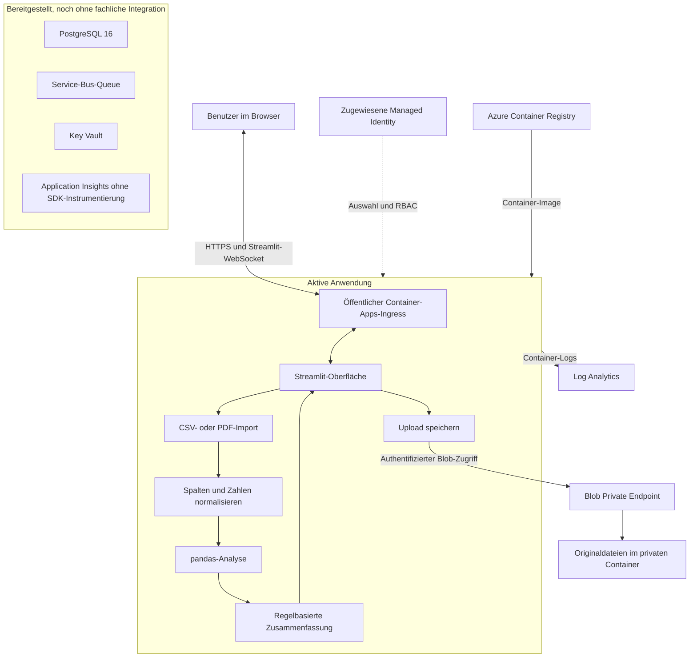

# Example Azure Depot PDF - Architektur im Detail

## Zweck und Aufbau

Example Azure Depot PDF verarbeitet Depotdateien in einer Streamlit-Webanwendung. Der Browser übernimmt Dateiauswahl und Ergebnisdarstellung. Im Container laufen Import, Normalisierung, Kennzahlenberechnung und Textzusammenfassung synchron in Python. Azure Blob Storage bewahrt hochgeladene Originaldateien auf.

Die Anwendung ist derzeit ein einzelner Python-Prozess ohne separates API-Backend oder Hintergrund-Worker. Azure Container Apps übernimmt den Container-Betrieb und den öffentlichen HTTPS-Endpunkt. Terraform beschreibt die Ressourcen und ihre Verknüpfungen.

## Gesamtübersicht

Durchgezogene Verbindungen beschreiben den aktuellen Anwendungs- und Betriebspfad. Die gepunktete Verbindung kennzeichnet die Identitätskonfiguration. Der getrennte Bereich enthält vorhandene Azure-Ressourcen, die der Analysecode noch nicht verwendet. Insbesondere existiert aktuell kein Nachrichtenfluss über Service Bus und keine Speicherung von Analyseergebnissen in PostgreSQL.

Die [ergänzenden Diagramme](architecture_diagram.md) zeigen Netzwerkstruktur und zeitlichen Ablauf eines Uploads.

## Fachliche Komponenten im Container

| Komponente | Verantwortung | Ein- und Ausgabe |
| --- | --- | --- |
| `app/app.py` | Streamlit-Sitzung, Dateiauswahl, Aufruf der Verarbeitung und Darstellung von Fehlern. | Upload entgegennehmen, Kennzahlen und Tabellen anzeigen. |
| `app/portfolio/storage.py` | Originaldatei bei konfiguriertem Azure-Zugriff speichern. | Datei einlesen, Blob schreiben und URI zurückgeben. |
| `app/portfolio/importer.py` | CSV lesen beziehungsweise PDF-Tabellen extrahieren, Spaltennamen vereinheitlichen und Zahlen parsen. | Hochgeladene Datei in einen pandas-DataFrame überführen. |
| `app/portfolio/analyzer.py` | Gesamtwert, Gewichte und Top-5-Positionen berechnen. Anlageklassen und Konzentrationen regelbasiert zuordnen. | Normalisierte Positionen in ein `AnalysisResult` umwandeln. |
| `app/portfolio/commentary.py` | Berechnete Werte in eine Textvorlage einsetzen. | Analyseergebnis in eine textuelle Zusammenfassung überführen. |
| `app/cli.py` | Den Import und die Analyse ohne Browser ausführen. | Lokalen Dateipfad lesen und Ergebnisse im Terminal ausgeben. |

Die CLI verwendet denselben Importer und dieselben Berechnungen wie die Weboberfläche. Sie ruft die Blob-Speicherung nicht auf. Die Textzusammenfassung benötigt keinen externen KI-Dienst.

## Ablauf eines Dateiimports

1. Der Benutzer öffnet die öffentliche Anwendung. Streamlit baut eine Sitzung auf und hält die interaktive Verbindung über einen WebSocket.
2. Der Browser überträgt eine CSV- oder PDF-Datei an die Anwendung.
3. Bei konfiguriertem Azure-Zugriff speichert `storage.py` die Originaldatei im Container `uploads`. Im Azure-Deployment verwendet der SDK-Client die zugewiesene Managed Identity. Ohne konfigurierte Storage-Verbindung überspringt die lokale Anwendung diesen Schritt.
4. Der Importer liest CSV-Spalten oder extrahiert Tabellen aus dem PDF. Er vereinheitlicht Namen wie `Wertpapier` und `Marktwert` und wandelt Zahlenwerte um. Erforderlich sind Name, Menge und Wert.
5. Der Analyzer summiert Positionswerte, berechnet prozentuale Gewichte und sortiert die Positionen. Er ermittelt die Top 5 und wendet feste Regeln für Konzentrationshinweise an.
6. Die Anwendung erstellt die regelbasierte Zusammenfassung und zeigt Positionen, Kennzahlen und Hinweise im Browser an.

**Reihenfolge und Fehlerverhalten:** Die Speicherung erfolgt vor der fachlichen Validierung. Eine nicht auswertbare Datei kann deshalb bereits als Blob vorliegen. Wenn die konfigurierte Blob-Speicherung fehlschlägt, beendet die Webanwendung den Ablauf mit einer Fehlermeldung, bevor sie die Analyse ausführt. Eine automatische Rückabwicklung des Uploads ist nicht implementiert.

## Datenhaltung und Lebensdauer

| Daten | Speicherort | Verhalten |
| --- | --- | --- |
| Originaldatei | Azure Blob Storage, wenn konfiguriert. | Überlebt einen Container-Neustart. Kein automatischer Löschjob für reguläre Uploads vorhanden. |
| Positionsdaten und Analyseergebnisse | Arbeitsspeicher des Anwendungsprozesses im Kontext der Streamlit-Ausführung. | Keine dauerhafte Ergebnisablage. Bei einer neuen Sitzung muss die Datei gegebenenfalls erneut hochgeladen werden. |
| Kennzahlen im Browser | Ausgabe der aktuellen Streamlit-Sitzung. | Keine serverseitige Historie oder Benutzerbibliothek implementiert. |
| Infrastruktur und Datenbankpasswort | Terraform-State auf der Entwicklungsmaschine. | Lokale Sicherung erforderlich, von Git ausgeschlossen. |

Blob-Versionierung sowie sieben Tage Soft Delete für Blobs und Container sind konfiguriert. Diese Wiederherstellungsfunktionen legen keine automatische Aufbewahrungsdauer für aktive Uploads fest. Ein konfigurierter Blob-URI ist außerdem kein öffentlicher Freigabelink.

## Netzwerkstruktur

Das virtuelle Netzwerk verwendet den Adressraum `10.40.0.0/16`.

| Subnetz | CIDR | Aufgabe |
| --- | --- | --- |
| `snet-containerapps` | `10.40.0.0/23` | Netzwerkintegration der Container-Apps-Umgebung, delegiert an `Microsoft.App/environments`. |
| `snet-private-endpoints` | `10.40.10.0/24` | Private Endpoints für Blob Storage und Key Vault. |
| `snet-postgres` | `10.40.20.0/24` | PostgreSQL Flexible Server, delegiert an `Microsoft.DBforPostgreSQL/flexibleServers`. |

Private DNS-Zonen und ihre VNet-Links unterstützen die Auflösung der privaten Dienste. PostgreSQL nutzt eine Integration in das delegierte Subnetz und keinen separaten Private Endpoint wie Blob Storage oder Key Vault.

Der Browser greift von außen auf den öffentlichen Container-Apps-Ingress zu. Die App erreicht Blob Storage über den für das VNet konfigurierten privaten Dienstpfad. Der öffentliche Storage-Endpunkt bleibt zusätzlich für die Container-Verwaltung durch Terraform aktiv. Authentifizierung und privater Container verhindern anonymen Dateizugriff. Key Vault und PostgreSQL haben keinen öffentlichen Netzwerkzugriff. Für Service Bus ist kein Private Endpoint konfiguriert.

Die vorhandene Subnetzaufteilung beschreibt die Netzwerkintegration. Zusätzliche Firewall- oder NSG-Regeln zur feingranularen Filterung zwischen den Subnetzen definiert die aktuelle Terraform-Konfiguration nicht.

## Identität und Berechtigungen

Terraform erstellt eine User Assigned Managed Identity und weist sie der Container App zu. Der Container-Runtimezugriff auf die Registry verwendet diese Identität direkt. Der Python-Code nutzt `DefaultAzureCredential`; die Umgebungsvariable `AZURE_CLIENT_ID` wählt die richtige zugewiesene Identität aus.

| Rolle | Geltungsbereich | Verwendung |
| --- | --- | --- |
| `AcrPull` | Container Registry | Image zum Container-Start laden. |
| `Storage Blob Data Contributor` | Storage Account | Uploads in Blob Storage speichern. Die Rolle gilt derzeit für den gesamten Storage Account. |
| `Key Vault Secrets User` | Key Vault | Für eine spätere Secret-Abfrage vorbereitet, aktuell ohne entsprechenden Codepfad. |

Managed Identity authentifiziert die Anwendung gegenüber Azure-Diensten. Eine Anmeldung des Benutzers an der Weboberfläche ist damit nicht verbunden. Benutzerkonten, rollenbasierte Sichtbarkeit von Depotdateien und Mandantentrennung sind noch nicht implementiert.

## Bereitstellung und Versionswechsel

GitHub Actions führt einen Docker-Build sowie den CLI-Smoke-Test aus. Ein Push löst kein automatisches Deployment in Azure aus.

`scripts/deploy-azure.sh` arbeitet in folgenden Schritten:

1. Azure-Zugriff und Terraform-Workspace auswählen. Vorhandenen Workspace-State auf den Subscription-Bezug prüfen.
2. Die Registry mit einem gezielten Terraform-Apply bereitstellen.
3. Das Linux/AMD64-Image remote in Azure bauen und mit einem Zeitstempel als Tag veröffentlichen.
4. Subscription und Image in einer lokalen, von Git ausgeschlossenen Variablendatei speichern.
5. Einen vollständigen Terraform-Plan erzeugen und anwenden. Der öffentliche Anwendungsendpunkt bleibt unverändert.

Die App verwendet das Consumption-Profil mit 0,5 vCPU und 1 GiB RAM. Minimum und Maximum liegen bei einer Instanz. Streamlit hält Sitzungs- und Upload-Zustand im Prozess. Mehrere Instanzen benötigen daher ein passendes Konzept für die Zuordnung von Anfragen und gegebenenfalls gemeinsam genutzten Zustand. Ein Instanzwechsel kann eine bereits geöffnete Browsersitzung unterbrechen. Single Revision ist keine Hochverfügbarkeitszusage.

## Betrieb und Fehlerdiagnose

| Signal | Aussage und Diagnoseweg |
| --- | --- |
| `/_stcore/health` liefert `200 ok` | Der Streamlit-Server antwortet. Das beweist noch keinen erfolgreichen Blob-Zugriff oder PDF-Import. |
| CLI-Test mit `samples/sample_depot.csv` | Prüft Import, Berechnung und Zusammenfassung ohne Web- oder Storage-Pfad. Erwartet: 8 Positionen und Gesamtwert 16.700,00. |
| CSV-Test im Browser | Prüft zusätzlich Sitzung, Upload, Blob-Speicherung und Tabellenanzeige. |
| Container-Logs in Log Analytics | Unterstützen die Diagnose von Start-, Laufzeit- und Azure-SDK-Fehlern. |
| Neustartalarm in Azure Monitor | Meldet einen Schwellenwert im Neustartmetriksatz. Die Action Group hat aktuell keine Benachrichtigungsempfänger. |
| Application Insights | Ressource und Connection String vorhanden. Python-SDK-Instrumentierung und fachliche Traces fehlen noch. |

Bei Storage-Fehlern sind Identitätsauswahl, RBAC, DNS und Netzwerkzugriff getrennt zu prüfen. Bei Importfehlern sind Dateistruktur und Spaltennamen relevant. Ein erfolgreicher Infrastruktur-Plan ersetzt keinen Funktionstest der Anwendung.

## Möglicher Ausbau

Ein späterer asynchroner Ablauf könnte nach der Blob-Speicherung eine Nachricht mit der Blob-Referenz in Service Bus schreiben. Ein Worker würde die Datei lesen, die vorhandene Analyse ausführen und Ergebnisse sowie Verarbeitungsstatus in PostgreSQL speichern. Die Weboberfläche könnte den Status abfragen und frühere Ergebnisse anzeigen.

Dieser Ausbau benötigt zusätzlich ein Job-Datenmodell, Zugriffsprüfung auf Dateien und Ergebnisse, ein Konzept für wiederholte Nachrichten sowie eine Fehler- und Wiederholungsbehandlung. Die bereits bereitgestellten Azure-Dienste allein stellen diese Funktionen noch nicht bereit. Vor dem Umgang mit vertraulichen Depotdaten sind Benutzeranmeldung und ein Aufbewahrungs- und Löschkonzept die nächsten fachlichen Architekturentscheidungen.
