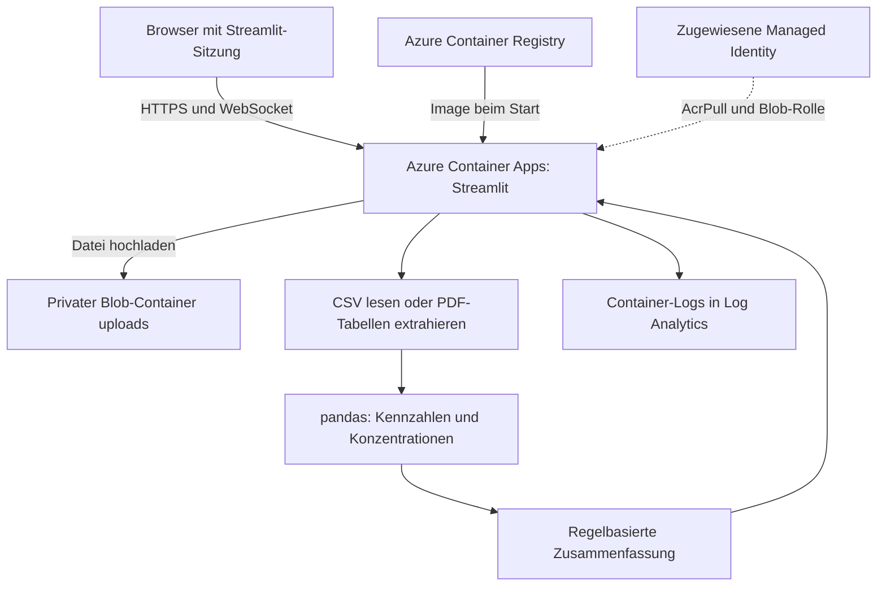
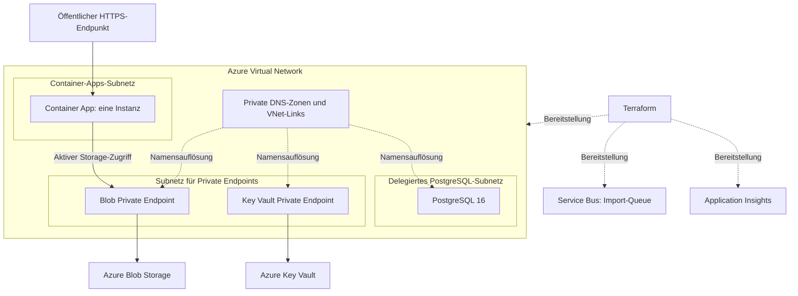
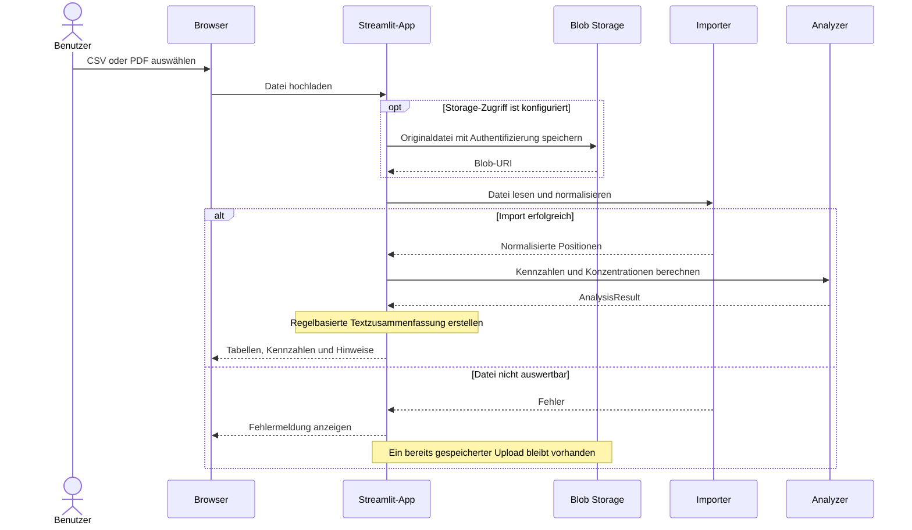

# Example Azure Depot PDF - Architektur

Die Diagramme beschreiben den aktuellen Code und die bereitgestellte Infrastruktur. Eine Ressource in Azure bedeutet nicht automatisch, dass die Anwendung sie bereits verwendet.

## Aktiver Anwendungspfad

Die App speichert einen Upload vor der Analyse in Blob Storage, sofern der Azure-Zugriff konfiguriert ist. Der Browser erhält die Ergebnisse über Streamlit. Der Zugriff auf den Blob-Container erfordert Authentifizierung.

## Bereitgestellte Netzwerk- und Erweiterungsstruktur

**Noch ohne fachliche Integration:** PostgreSQL, Service Bus und Key Vault. Application Insights ist bereitgestellt, aber der Python-Code sendet noch keine instrumentierten Anwendungstraces. Deshalb zeigen die Diagramme keine aktiven Analyseverbindungen zu diesen Diensten.

**Netzwerkgrenzen:** PostgreSQL und Key Vault haben keinen öffentlichen Netzwerkzugriff. Blob Storage hat einen Private Endpoint und einen weiterhin aktivierten öffentlichen Endpunkt für die Verwaltung durch Terraform. Anonyme Zugriffe sind deaktiviert. Die Weboberfläche ist öffentlich und hat noch keine Benutzeranmeldung.

**Skalierung:** Single Revision, eine Instanz mit 0,5 vCPU und 1 GiB RAM. Eine spätere Skalierung auf mehrere Instanzen benötigt ein Konzept für Streamlit-Sitzungen und Datei-Uploads.

## Zeitlicher Ablauf eines Dateiimports

Schlägt die konfigurierte Blob-Speicherung fehl, erreicht die Ausführung den Importer nicht. Die App zeigt den Fehler an. Das Diagramm beschreibt den Webpfad; die CLI liest lokale Dateien ohne Blob-Speicherung.

Die [ausführliche Architekturbeschreibung](architecture.md) erklärt Komponenten, Datenhaltung, Identitäten, Netzwerkadressen und Betrieb.
