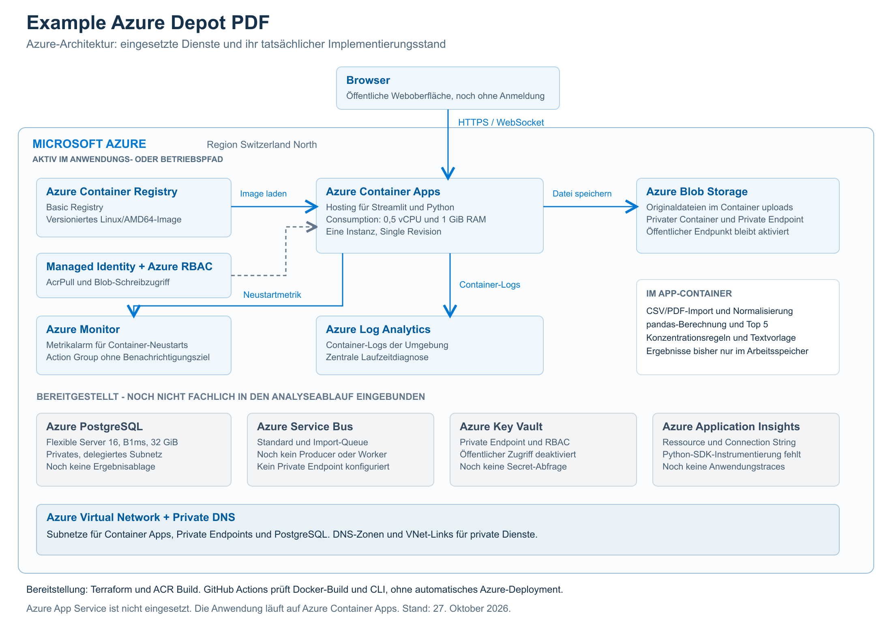
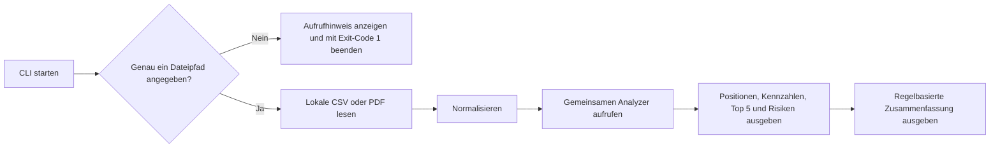
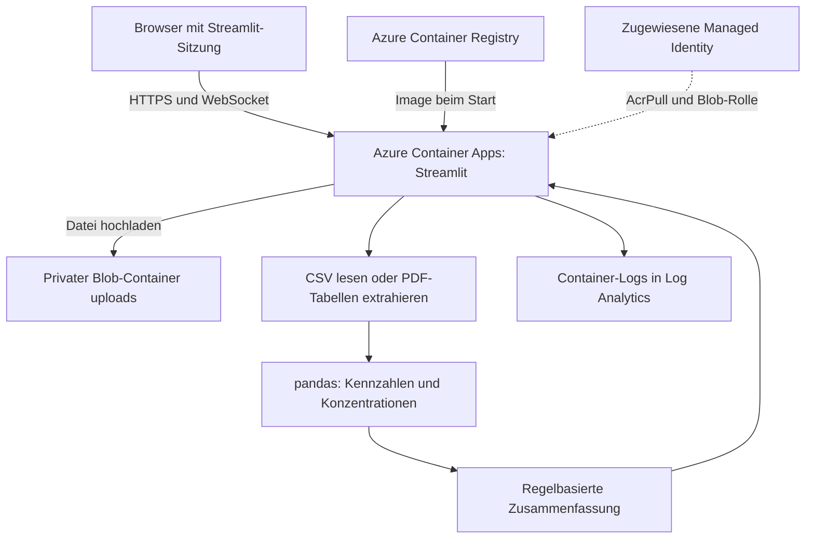
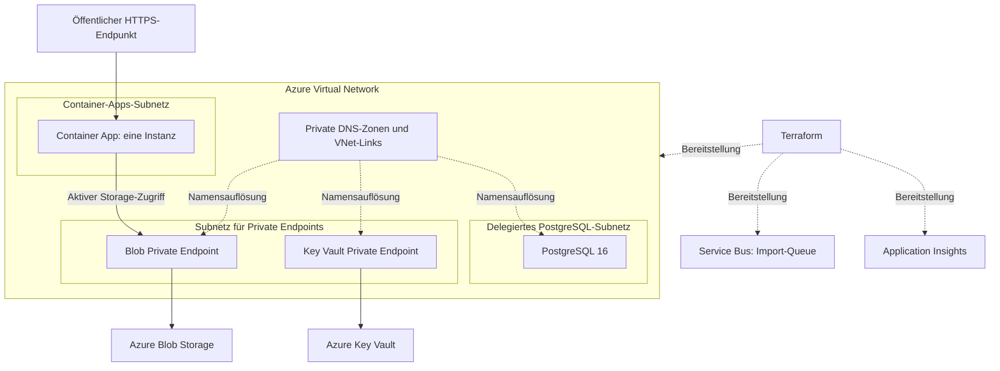
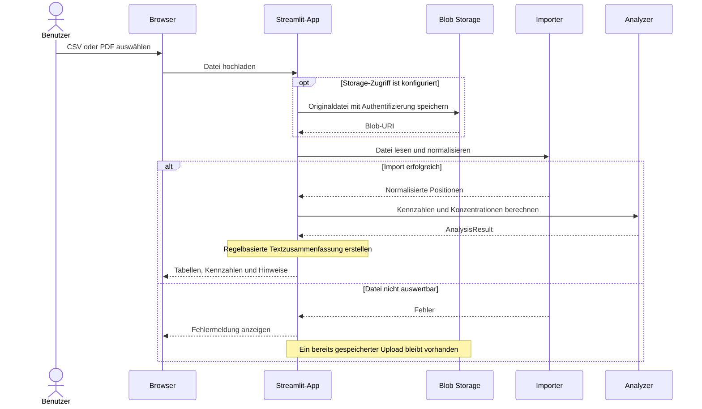

# Example Azure Depot PDF - Architektur

Die Diagramme beschreiben den aktuellen Code und die bereitgestellte Infrastruktur. Eine Ressource in Azure bedeutet nicht automatisch, dass die Anwendung sie bereits verwendet.

## Azure-Dienste im Überblick

[Skalierbare SVG-Version öffnen](assets/azure-architecture.svg). Das Bild zeigt konkrete Azure-Dienste. Die folgenden Diagramme ergänzen den fachlichen Ablauf und die Netzwerkdetails.

## Vollständiger Ablauf der Webanwendung

Dieses Diagramm folgt der Aufrufreihenfolge in `app/app.py`. Es zeigt die fachliche Verarbeitung innerhalb einer Streamlit-Ausführung. Bei einer neuen Dateiauswahl startet Streamlit die Verarbeitung erneut.

```mermaid
flowchart TD
    Start([Seite öffnen oder Streamlit erneut ausführen]) --> Page[Seitentitel und Datei-Upload anzeigen]
    Page --> File{Datei ausgewählt?}
    File -->|Nein| Wait[Hinweis auf CSV, PDF und Beispieldatei anzeigen]
    Wait --> EndWait([Auf Eingabe warten])
    File -->|Ja| Storage{Azure-Storage-Verbindung konfiguriert?}
    Storage -->|Nein| Read[Datei für den Import bereitstellen]
    Storage -->|Ja| Auth{Connection String vorhanden?}
    Auth -->|Ja| Conn[Blob-Client mit Connection String erstellen]
    Auth -->|Nein| Identity[DefaultAzureCredential mit zugewiesener Managed Identity]
    Conn --> Save
    Identity --> Save[Blob-Name aus UTC-Zeit, UUID und bereinigtem Dateiname bilden]
    Save --> Container[Container-Erstellung versuchen, nur bereits vorhandenen Container abfangen]
    Container --> Upload[Originaldatei hochladen und Leseposition zurücksetzen]
    Upload -->|Erfolgreich: Blob-URI merken| Read
    Upload -->|Fehler| Error[Processing failed mit Fehlertext anzeigen]
    Read --> Type{Dateiendung CSV?}
    Type -->|Ja| CSV[CSV mit mehreren Trennzeichen-Versuchen lesen]
    Type -->|Nein: PDF aus der Dateiauswahl| PDF[PDF-Seiten mit pdfplumber öffnen und Tabellen extrahieren]
    PDF --> Tables{Tabellenzeilen gefunden?}
    Tables -->|Nein| Error
    Tables -->|Ja| Normalize
    CSV -->|Lesbar| Normalize[Spaltennamen vereinheitlichen und Pflichtspalten prüfen]
    CSV -->|Nicht lesbar| Error
    Normalize -->|Fehlende Spalten oder ungültige Zahlen| Error
    Normalize -->|Erfolgreich| Numbers[Menge und Wert parsen, optionale Spalten ergänzen und fehlende Werte entfernen]
    Numbers --> Currency{Angegebene Währungscodes einheitlich?}
    Currency -->|Nein| Error
    Currency -->|Ja| Total[Positionswerte zum Gesamtwert summieren]
    Total --> Positive{Gesamtwert größer als null?}
    Positive -->|Nein| Error
    Positive -->|Ja| Weights[Gewichte berechnen und Anlageklasse sowie Tech- und USA-Bezug zuordnen]
    Weights --> Sort[Nach Positionswert sortieren und Top 5 bestimmen]
    Sort --> Risks[Konzentrationen anhand fester Schwellenwerte prüfen]
    Risks --> Result[AnalysisResult mit Positionen und Kennzahlen erstellen]
    Result --> Comment[Regelbasierte Textzusammenfassung erzeugen]
    Comment --> Success[Importbestätigung und gegebenenfalls Blob-URI anzeigen]
    Success --> Metrics[Gesamtwert, Positionszahl und größtes Gewicht anzeigen]
    Metrics --> Positions[Alle Positionen und Top-5-Tabelle anzeigen]
    Positions --> HasRisk{Konzentrationshinweise vorhanden?}
    HasRisk -->|Ja| Warnings[Jeden Hinweis als Warnung anzeigen]
    HasRisk -->|Nein| NoRisk[Hinweis auf keine erkannten Konzentrationen anzeigen]
    Warnings --> Summary[Textzusammenfassung anzeigen]
    NoRisk --> Summary
    Summary --> Done([Ergebnis in der aktuellen Sitzung sichtbar])
    Error --> Failed([Verarbeitung für diesen Durchlauf beendet])
    classDef failure fill:#FDECEC,stroke:#B42318,color:#7A271A;
    class Error,Failed failure;
```

**Gemeinsame Fehlerbehandlung:** Der äußere `try`/`except`-Block umfasst Storage, Import, Analyse, Textgenerierung und Ergebnisdarstellung. Eine Ausnahme in einem dieser Schritte führt zur Fehlermeldung. Das Diagramm zeigt typische Fehlerstellen ausdrücklich; der Handler gilt auch für nicht eingezeichnete Laufzeitfehler. Schlägt etwa die Tabellenanzeige fehl, können vorher bereits Kennzahlen sichtbar sein.

**Dateizustand:** Die Speicherung passiert vor der Validierung. Ein danach fehlgeschlagener Import oder eine fehlerhafte Analyse löscht den gespeicherten Blob nicht automatisch. Der Blob-Name kombiniert UTC-Zeit, eine zufällige UUID und den bereinigten Dateinamen. Der Upload überschreibt vorhandene Blobs nicht. Nur der erwartete Fehler für einen bereits vorhandenen Container wird bei der Container-Erstellung abgefangen. Andere Azure-Fehler beenden den Ablauf.

**Konzentrationsregeln:** Ab 25 % Gewicht erscheint eine Einzelpositions-Konzentration, zwischen 15 % und unter 25 % ein Hinweis auf eine große Position. Weitere Schwellen sind 70 % für die Top 5, 40 % für erkannte Technologiepositionen und 50 % für erkannte USA-Bezüge. Diese Zuordnungen beruhen auf Schlüsselwörtern, nicht auf externen Stammdaten.

## Ablauf über die Kommandozeile

Die CLI verwendet Importer und Analyzer der Webanwendung. Sie hat keinen Blob-Upload. Erwartete Datei- und Validierungsfehler erscheinen als Meldung auf stderr und führen zum Exit-Code 1. Eine erfolgreiche Auswertung endet mit Exit-Code 0.

## Aktiver Anwendungspfad

Die App speichert einen Upload vor der Analyse in Blob Storage, sofern der Azure-Zugriff konfiguriert ist. Der Browser erhält die Ergebnisse über Streamlit. Der Zugriff auf den Blob-Container erfordert Authentifizierung.

## Bereitgestellte Netzwerk- und Erweiterungsstruktur

**Noch ohne fachliche Integration:** PostgreSQL, Service Bus und Key Vault. Application Insights ist bereitgestellt, aber der Python-Code sendet noch keine instrumentierten Anwendungstraces. Deshalb zeigen die Diagramme keine aktiven Analyseverbindungen zu diesen Diensten.

**Netzwerkgrenzen:** PostgreSQL und Key Vault haben keinen öffentlichen Netzwerkzugriff. Blob Storage hat einen Private Endpoint und einen weiterhin aktivierten öffentlichen Endpunkt für die Verwaltung durch Terraform. Anonyme Zugriffe sind deaktiviert. Die Weboberfläche ist öffentlich und hat noch keine Benutzeranmeldung.

**Skalierung:** Single Revision, eine Instanz mit 0,5 vCPU und 1 GiB RAM. Eine spätere Skalierung auf mehrere Instanzen benötigt ein Konzept für Streamlit-Sitzungen und Datei-Uploads.

## Zeitlicher Ablauf eines Dateiimports

Schlägt die konfigurierte Blob-Speicherung fehl, erreicht die Ausführung den Importer nicht. Die App zeigt den Fehler an. Das Diagramm beschreibt den Webpfad; die CLI liest lokale Dateien ohne Blob-Speicherung.

Die [ausführliche Architekturbeschreibung](architecture.md) erklärt Komponenten, Datenhaltung, Identitäten, Netzwerkadressen und Betrieb.
